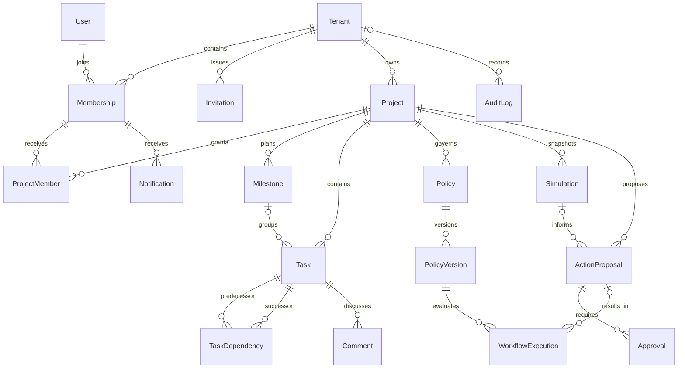

# ProjectOS — Logical domain and database design
Proposal only: no Prisma schema, tables, migrations or database exists as part of this work.

## Common conventions
UUID id is every entity's primary identifier. Tenant-owned entities carry non-null tenantId, createdAt and updatedAt; mutable rows have integer revision. Global identity/session/platform records are the explicit exceptions. Organization is the product label for Tenant.
Every tenant parent exposes unique (tenantId,id). Project-scoped parents also expose (tenantId,projectId,id); child foreign keys carry the same tuple, preventing cross-tenant and cross-project joins even when an ID is known. Project references Tenant; Membership references Tenant and global User. FKs to assignees/actors use tenant+membership, not a bare user ID. Service actors use an explicit actorType and actorId; never impersonate a user.
Indexes listed below are in addition to PK and unique-constraint indexes. Indexes are workload proposals to verify with query plans. Archive instead of cascade-delete by default; domain history references archived rows. All deletion jobs require tenant context.

## Entity catalogue
| Entity / scope | Purpose and important attributes | Relationships/cardinality | Uniqueness and validation | Query indexes | Retention/deletion |
|---|---|---|---|---|---|
| User / global | OIDC issuer, subject, verifiedEmail, displayName, status | 1:N Membership, Session; optional PlatformRole | Unique issuer+subject; email not identity key; suspended blocks sessions | status | Deactivate; pseudonymize after retention review; never cascade audit |
| Tenant / tenant root | name, slug, timezone, status, securityRevision | 1:N Membership and Project | Unique slug; valid IANA timezone; ≥1 active Owner | status | Archive; future purge is explicit staged job with legal/retention review |
| Membership / tenant | userId, orgRole Owner/Admin/Member, status, joinedAt | N:1 User/Tenant; 1:N ProjectMember | Unique tenant+user; role allowlist; no last-owner removal | tenant+status+orgRole | Deactivate preserves attribution; removal revokes project access immediately |
| Invitation / tenant | normalizedEmail, role, tokenHash, expiresAt, invitedBy, redeemedAt, status | N:1 Tenant and inviter Membership; optional acceptedMembership | Unique tokenHash; one pending tenant+email via partial uniqueness; token single-use, 7-day TTL; cannot invite owner directly | tenant+status+expiresAt | Delete token hash on completion; redact email after 90 days |
| Project / tenant | name, description, status, startDate, targetDate, capacityUnits, planRevision | N:1 Tenant; 1:N project children | Name need not be unique; dates valid; capacity 1..100; archive blocks writes | tenant+status+createdAt+id | Archive; retain historical snapshots |
| ProjectMember / tenant+project | membershipId, projectRole | N:1 Project and Membership | Unique tenant+project+membership; active membership required for grants and use | tenant+membership+project | Deactivate/remove role; history in audit |
| Milestone / tenant+project | name, targetDate, critical, completion calculated from linked tasks | N:1 Project; 1:N Task | Task may belong to ≤1 milestone initially; empty milestone completion is null | tenant+project+targetDate | Archive; cannot delete while referenced |
| Task / tenant+project | title, status, assigneeMembershipId?, milestoneId?, priority, remainingEffortDays, resourceUnits, releaseOffset, actualFinishOffset?, progressPercent | N:1 Project; optional assignee Membership and Milestone; 1:N Comment; dependency edges | Effort integer 0..3650; units 1..capacity; progress 0..100; done requires actual finish and remaining effort 0; status does not infer remaining effort | tenant+project+status; tenant+assignee+status; tenant+project+milestone | Archive only after dependent edges handled through approved proposal |
| TaskDependency / tenant+project | predecessorTaskId, successorTaskId, type FS | N:1 Project, two Task FKs | Unique tenant+project+predecessor+successor; no self-edge/cross-project/cycle; entire graph checked inside serialized plan mutation | tenant+project+successor; tenant+project+predecessor | Remove only via versioned plan proposal; old graph remains in snapshots |
| Comment / tenant+project | taskId, authorMembershipId, body, editedAt | N:1 Task/author | Body 1..10,000 chars; author or manager moderation; sanitize rendering; no raw HTML | tenant+project+task+createdAt+id | Soft-delete body; audit moderation without preserving sensitive body |
| Policy / tenant+project | name, status draft/active/disabled, activeVersionId? | N:1 Project; 1:N PolicyVersion | Unique tenant+project+name; active pointer must reference validated published version of same policy | tenant+project+status | Disable; no deletion of referenced policy |
| PolicyVersion / tenant+project | policyId, versionNumber, inputText, structuredDefinition, definitionHash, schemaVersion, validationReport, createdBy, publishedBy?, publishedAt? | N:1 Policy; 1:N WorkflowExecution | Unique tenant+policy+version; immutable definition; validation binds exact hash; active scope is project initially | tenant+policy+versionNumber | Retain for lifetime of referencing executions; redact input text by policy |
| WorkflowExecution / tenant+project | policyVersionId, eventId, eventSnapshotHash, result, matchedFacts, proposalId?, errorCode | N:1 PolicyVersion; optional ActionProposal | Unique tenant+policyVersion+eventId; state queued/evaluated/awaitingApproval/executed/skipped/failed; never overwrite history to simulate success | tenant+project+createdAt+id; tenant+state | 365 days default, longer while proposal references remain |
| Simulation / tenant+project | createdBy, snapshot, baselineRevision, overrides, inputHash, engineVersion, calendarVersion, baselineResult, scenarioResult, resultHash, status, errorCode | N:1 Project/creator; 0:N derived proposals | Immutable inputs/results; draft is client-side; queued/running/succeeded/failed; same hash can recur as separate run, results must agree | tenant+project+createdAt+id; tenant+status | 90 days unless linked to retained proposal, then keep required evidence |
| ActionProposal / tenant+project | sourceType manual/policy/simulation, sourceId?, proposerMembershipId, actionList, payloadHash, baselineRevision, state, expiresAt, executedAt? | N:1 Project; 1:N Approval; optional WorkflowExecution or Simulation | Immutable payload and target; discriminated source FK enforced; state pending/approved/rejected/expired/stale/executed; action allowlist | tenant+state+createdAt; tenant+project+baselineRevision | 365 days; retain approval and execution evidence together |
| Approval / tenant+project | proposalId, approverMembershipId, decision approve/reject, payloadHash, decidedAt, reason | N:1 ActionProposal/approver | Unique tenant+proposal+approver; one terminal decision; approver differs from proposer; no approval edits | tenant+proposal+decidedAt | Retain with proposal; revocation affects eligibility, not historical record |
| AuditLog / tenant nullable only for global events | actorType, actorId, tenantId?, projectId?, action, targetType/id, requestId, outcome, redactedDelta, occurredAt | Logical target refs; optional Tenant/Project; no destructive cascade | Append-only runtime privileges; immutable event UUID; global audit separated from tenant queries | tenant+occurredAt+id; tenant+project+occurredAt; requestId | 365 days proposed; purge via restricted audited maintenance role |
| Notification / tenant | recipientMembershipId, projectId?, eventId, kind, safeSummary, readAt | N:1 Membership; optional Project | Unique tenant+recipient+event+kind; recipient authority rechecked when rendered | tenant+recipient+readAt+createdAt | 90 days; remove content on access revocation |

All entities above have UUID PK id. Composite unique keys supplement the PK; they do not replace scope validation.

## Supporting entities justified by architecture
| Entity / scope | Attributes and relationships | Constraints/indexes | Lifecycle |
|---|---|---|---|
| Session / global | userId, tokenHash, csrfHash, expiresAt, idleExpiresAt, revokedAt; User 1:N | Unique tokenHash; index user+revokedAt and expiry | Delete expired credentials within 24 h |
| AuthAttempt / global | stateHash, nonceHash, encrypted PKCE verifier, returnPath, expiresAt, consumedAt | Unique stateHash; 10 min TTL; local returnPath allowlist | Delete immediately after successful use or expiry |
| PlatformRole / global | userId, role SuperAdmin, grantedAt | Unique user+role; audited restricted grant | Revoke without touching tenant memberships |
| ProjectEvent / tenant+project | type, projectRevision, snapshotHash, minimal payload, actor; Project 1:N | Unique tenant+project+revision+type+eventKey; index delivery state | 365 days if execution evidence depends on it |
| Job / tenant+project | kind, actor context, inputRef/hash, status, attempts, leaseUntil, error | Unique tenant+kind+dedupeKey; status+leaseUntil index | Remove operational payload after 30 days; retain business outcome elsewhere |
| OutboxEvent / tenant | eventId, channel, payloadRef, deliveredAt, attempts | Unique tenant+event+channel; pending+createdAt index | 30 days after delivery; never store credentials |
| IdempotencyRecord / tenant+actor | route, key, requestHash, responseRef, expiresAt | Unique tenant+actor+route+key; expiry index | 24 h; no secret response bodies |
| InsightReport / tenant+project | revision, asOf, facts, evidenceRefs, optional explanation, provider/modelVersion, status | Index tenant+project+createdAt; evidence same tenant/project | 90 days; no full raw prompts by default |

## Logical relationships

Diagram omits supporting entities and composite keys for readability; catalogue is authoritative. Conditional proposal source relationships require a constrained discriminated type rather than an unrestricted polymorphic ID.

## Integrity and concurrency
Task graph changes lock Project, check expected planRevision and run cycle detection against the complete proposed graph before commit. Concurrent individually-valid edges cannot create a cycle. Assignment requires active same-tenant membership and project access; suspended assignees retain attribution but cannot operate. ProjectMember cannot grant beyond grantor authority. Changing Membership invalidates derived access without relying on client refresh.
Policy active-version pointer, approval hash match and proposal state changes are transactional. Plan snapshots store all calculation-relevant facts, canonical ordering, calendar and engine versions; no later live-row lookup is allowed during calculation.

## PostgreSQL RLS evaluation
Selected direction: application scoping plus composite foreign keys from first backend slice; RLS defense-in-depth required before real tenant data release, contingent on an integration proof. RLS is NOT enabled now.
Future policies use tenant context for USING and WITH CHECK; absent context fails closed. Runtime role must not be owner, superuser or BYPASSRLS; migration role separate; FORCE ROW LEVEL SECURITY considered for owner paths. RLS does not replace project authorization. Referential-integrity checks and privileged roles can bypass ordinary row policies; sanitize constraint errors. [PostgreSQL documentation](https://www.postgresql.org/docs/current/ddl-rowsecurity.html).
With pooling, set tenant context transaction-locally using a parameterized set_config within a short Prisma interactive transaction and use only that transaction client. Never session-level SET followed by unrelated pooled queries. Release/rollback must clear context; test tenant A then B on reused connections and no-context access. Prisma transaction behavior and timeout management require version-specific tests. No AI/network calls inside transactions. [Prisma transactions](https://www.prisma.io/docs/orm/fundamentals/transactions).
RLS policies, partial indexes, check constraints and grants may need reviewed SQL migrations beyond Prisma models in a future phase. Prisma is not assumed to enforce graph cycles, publication immutability or all cross-table invariants. Migration/pooled connection choices must be verified with selected Neon/Prisma versions.
