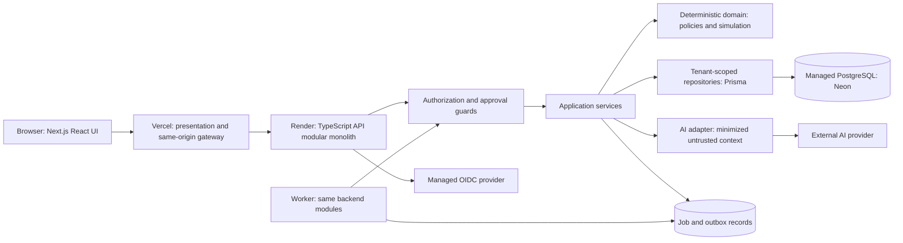

# ProjectOS — System architecture
Status: proposed design only. See [requirements](requirements.md) for scope and assumptions.

## Topology and trust boundaries

Arrows describe logical communication, not implemented integrations. Job/outbox records live in the same PostgreSQL database; no separate broker. An initial bounded request-driven demo can process jobs while the API is awake; unattended scheduling requires an always-on worker and explicit hosting review.

## Layer ownership
- Presentation: Next.js/React/TypeScript/Tailwind, navigation, accessible controls, local draft state and typed view models.
- Frontend gateway: same-origin forwarding and cookie transport only, no Prisma, policy rules, approval decisions or AI secrets.
- API/application: proposed Fastify TypeScript service; contract parsing, identity resolution, permissions, transactions, idempotency, orchestration and error mapping.
- Domain: pure typed policy validator/evaluator, fixed authorization rules, plan validation, schedule calculation and proposal state machine. No network calls in calculations.
- Persistence: repositories demand verified TenantContext, scoped keys and explicit transaction clients; Prisma plus reviewed database constraints. Controllers cannot call an unscoped database client.
- AI: provider-independent adapter for candidate policies and explanations. Provider output never supplies authoritative permissions, executable code, SQL or calculated dates.
- External services: OIDC and AI providers; future mail/object storage behind adapters and separately authorized scopes.

## Authentication and request lifecycle
1. Browser starts /api/v1/auth/login on the frontend origin. Gateway forwards to backend, which creates short-lived one-use state, nonce and PKCE verifier and redirects to OIDC.
2. Callback returns to the same frontend origin, forwarded to backend. Backend validates authorization response, issuer/audience/signature/nonce, exchanges code with PKCE and maps (issuer, subject) to User. Email alone never links accounts.
3. Backend creates opaque random session, stores only token hash and sets Secure, HttpOnly, SameSite=Lax host-only cookie through gateway. Proposed 30 min idle/12 h absolute expiry; rotate at login/privilege elevation, revoke at logout/suspension. Require recent reauthentication for owner transfer.
4. Browser requests /api/v1/tenants/{tenantId}/projects. Tenant ID is a selector, never proof. Backend checks session, active user/tenant, active Membership, requested resource and role. No JWT organization claim is trusted as current membership.
5. Verified immutable context carries userId, tenantId, membershipId, permission scope and requestId through services/repositories/jobs. Cross-tenant or hidden resource is 404; insufficient action on visible resource is 403.
6. Domain validation runs before transaction. Mutation transaction rechecks authority and revision, persists state plus audit plus outbox. Response uses contract DTOs without ORM internals.
7. UI consumes DTO; error includes safe code and requestId. Client caches key by user + tenant + project and clears on switching/logout.

Gateway forwards only allowlisted headers/routes, strips client identity headers, never logs cookies, never caches authenticated responses, and does not expose an open proxy. Backend validates every session itself. TLS is required on both hops. Browser uses no cross-site backend cookies. Direct browser CORS is denied by default; server-to-server gateway traffic does not rely on CORS for authorization. Mutation requests require CSRF token bound to session and exact Origin validation at gateway/backend forwarding boundary.

## Policy and approval lifecycle
Project events are persisted with outbox in the originating transaction. Evaluator loads authorized event snapshot and published immutable PolicyVersion; deterministic predicates emit a WorkflowExecution and immutable ActionProposal. Notification-only actions may execute under a narrow project service identity after policy publisher authority is rechecked. Plan changes and escalation priority changes require independent Owner/Admin approval. Fixed approval controls cannot be disabled by an authored policy.
At execution: lock proposal, verify hash/state/expiry, current proposer and executor permissions, current approver eligibility, tenant state, live project revision and current policy gates; apply allowlisted delta with audit/outbox atomically. Replay returns the existing execution; stale plan yields 409 and a replacement proposal. See [policy engine](policy-engine.md).

## Simulation and intelligence lifecycle
Simulation service takes a consistent project snapshot/revision, validates scenario overrides and budgets, stores immutable input, then runs versioned pure scheduling logic. Results are stored under Simulation only. Comparison includes baseline and scenario outputs derived from that same snapshot. Applying a scenario creates an ActionProposal, never an automatic write.
Risk facts use calculated lateness, zero-slack tasks and overdue blockers. Intelligence DTO contains evidence IDs/revision/as-of time, facts and optional validated AI explanation. Missing data is explicit. Provider errors do not suppress deterministic results. See [simulation](simulation-engine.md).

## Transactions, jobs and concurrency
All plan changes lock project/revision and increment planRevision; membership/role changes serialize against execution checks using shared authorization-lock convention (tenant security revision plus affected memberships). A transaction must read/lock authority records before execution, so revocation and execution have a defined serial order.
Job stores tenant/project/actor, action kind, input revision/hash, attempts and lease. Worker revalidates context, bounds work, renews lease, retries transient failures with exponential backoff (max 3), and records terminal errors. Outbox delivery is at-least-once; recipient+event+channel uniqueness suppresses duplicate notifications. No exactly-once network-delivery claim. Startup/request drain is only a demo convenience, not a reliable cron service.

## Error handling and observability
Validation errors 422; malformed input 400; conflict/stale revision 409; rate limits 429; upstream unavailable 503. Unexpected errors are 500 with requestId, no stack trace to browser. See contract-specific errors.
Structured operational logs: time, service, requestId, route, status, latency and pseudonymous tenant/actor IDs; exclude policy text, prompts, cookies and task bodies. Audit records describe actor, target, action, revision and redacted delta, separate from diagnostic logs. Significant mutation and audit commit together; failure to write audit aborts critical mutation. Denials go to security events with supplied tenant selectors treated as untrusted.
Metrics: error/latency, pool exhaustion, queue age, retries, simulation time, AI cost/timeouts, auth denials and approval conflicts; alert on cross-tenant test failures, sustained 5xx, delayed jobs and budget thresholds. Production alert destinations remain undecided.

## Environment and deployment plan
Development, staging and production have distinct database projects/credentials, OIDC clients/callbacks, secrets and AI budgets. Preview deployments use synthetic data only and no production session cookies/secrets. Choose API and DB regions together; frontend is geographically distributed. No secrets use NEXT_PUBLIC_ prefix. GitHub Actions later runs checks and environment-protected release jobs; no automatic production migrations before approval.
Vercel hosts frontend; Render hosts API; Neon hosts PostgreSQL. Stateless API/filesystem, portable adapters, PostgreSQL-compatible schema and documented backup/restore permit migration. Quotas, sleep and commercial limits are tracked in [AD-13](architecture-decisions.md#ad-13-cloud-hosting). No resources have been provisioned.

## Design trade-offs
Modular monolith minimizes deployment/transaction complexity while keeping separable modules. REST fits explicit resource and action contracts. Shared-schema tenancy lowers cost; composite foreign keys, server checks and planned RLS provide layers rather than an assumed single defense. A same-origin gateway simplifies cookies at the cost of one hop and timeout coordination. RLS and durable background processing require integration proof before a real-data release.
